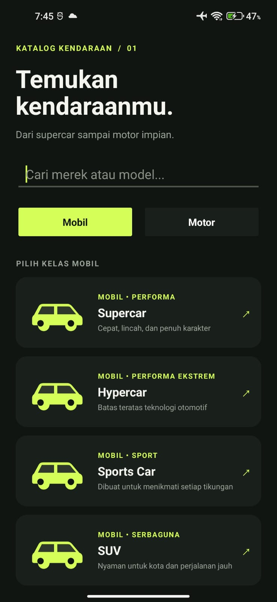
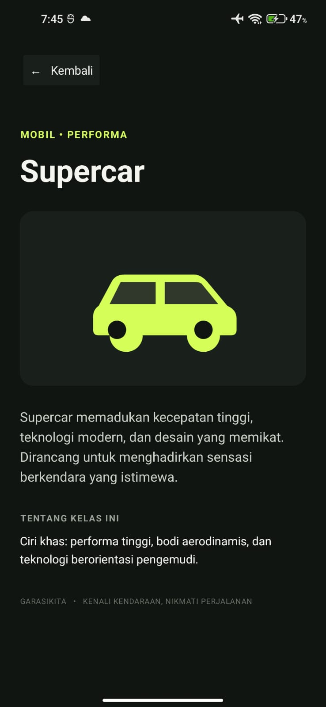

# Project Mobile App (tema yang saya ambil itu Applikasi untuk pilih Kendaraan) Nama Applikasi GarasiKita
# Nama : Daffa Syafiq Faiz
# NIM : 24091006

# GarasiKita

Aplikasi katalog kendaraan Android dengan Kotlin dan tampilan XML. Tema mobil dan motor dipilih karena mudah diperagakan dalam dua layar: katalog kategori dan halaman detail.

## Fitur

- Dua kategori utama: mobil dan motor.
- Delapan kelas untuk setiap kategori, termasuk Supercar, Hypercar, Superbike, dan Adventure.
- Pencarian nama kelas dan kategori.
- Halaman detail dengan ringkasan dan ciri khas setiap kelas.
- Tombol kembali, ilustrasi kendaraan vektor, dan tampilan gelap beraksen hijau.
- Berjalan offline; tidak memerlukan akun atau izin khusus.

## Layar

1. **Katalog** — pilih Mobil atau Motor, cari kelas kendaraan, lalu ketuk kartu untuk membuka detail.
2. **Detail** — membaca ringkasan kelas kendaraan dan kembali ke katalog.

## Cara menjalankan di Android Studio

1. Pasang Android Studio dan komponen Android SDK Platform 35 serta Android SDK Build-Tools yang direkomendasikan oleh Android Studio.
2. Buka folder proyek ini di Android Studio dan tunggu Gradle menyelesaikan sinkronisasi (internet dibutuhkan pertama kali untuk mengunduh plugin dan Gradle 8.9).
3. Sambungkan HP Android dengan USB, aktifkan **Opsi pengembang** dan **USB debugging**, lalu izinkan komputer saat prompt muncul di HP.
4. Pilih perangkat HP di daftar perangkat Android Studio, kemudian tekan **Run ▶**.

## Membuat APK untuk dipasang di HP

Di Android Studio, pilih **Build → Build Bundle(s) / APK(s) → Build APK(s)**. APK debug akan berada di `app/build/outputs/apk/debug/app-debug.apk`. Pindahkan APK ke HP dan buka file tersebut untuk memasang. Android mungkin meminta izin memasang aplikasi dari sumber itu.

Build dari terminal VS Code, setelah `local.properties` menunjuk ke lokasi Android SDK yang benar:

```powershell
.\gradlew.bat assembleDebug
```

Untuk memasang APK dari komputer dengan Android SDK Platform-Tools:

```powershell
adb install -r app/build/outputs/apk/debug/app-debug.apk
```

## Screenshot untuk pengumpulan

<p align="center">
  
  
</p>

## Struktur singkat

- `app/src/main/java/com/garasikita/app/MainActivity.kt` — data katalog, pencarian, dan navigasi antarlayar.
- `app/src/main/res/layout/` — layout XML untuk katalog, kartu daftar, dan detail.
- `app/src/main/res/drawable/` — ilustrasi kendaraan vektor dan latar kartu.
- `app/src/main/AndroidManifest.xml` — deklarasi aplikasi dan activity utama.
